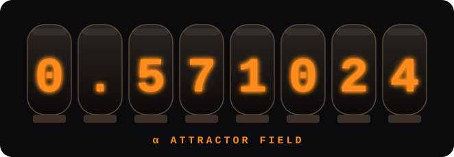
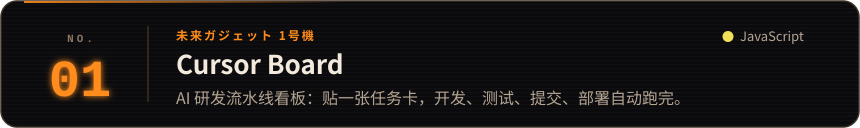
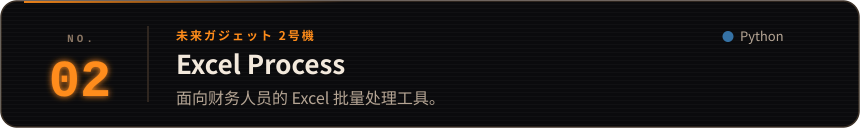
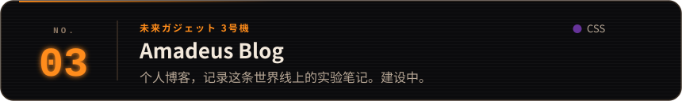

 

<!-- WORLDLINE:START -->
**Current worldline:** `0.571024` · α Attractor Field
<!-- WORLDLINE:END -->

<a href="https://github.com/AmadeusOfficial/AmadeusOfficial/issues/new?title=D-Mail%3A%20&body=Write%20your%20message%20in%20the%20%2A%2Atitle%2A%2A%2C%20right%20after%20D-Mail%3A%20%28max%2036%20bytes%29.%0A%0ASubmit%20this%20issue%20and%20Amadeus%20will%20shift%20the%20worldline.%20The%20reply%20arrives%20in%20about%20a%20minute.%0A%0AEl%20Psy%20Kongroo."><b>📨 Send a D-Mail</b></a>

Write up to 36 bytes after <code>D-Mail:</code> in the issue title. Every message reroutes the worldline.

## 📨 D-Mail Log

Messages sent to the past. Only the latest five survive each shift.

<!-- DMAIL:START -->
_No D-Mail has reached this worldline yet. Be the first to change the past._
<!-- DMAIL:END -->

## 🔬 未来ガジェット研究所 · Future Gadget Lab

  
  
  

<i>これもシュタインズ・ゲートの選択か。</i>

**El Psy Kongroo.**

